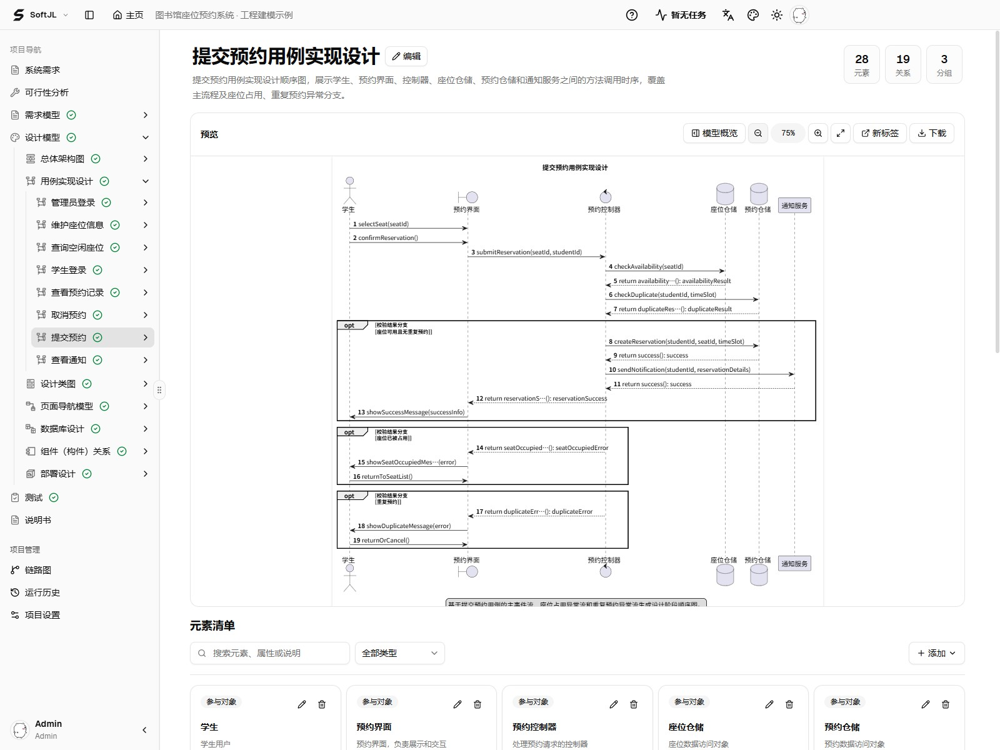
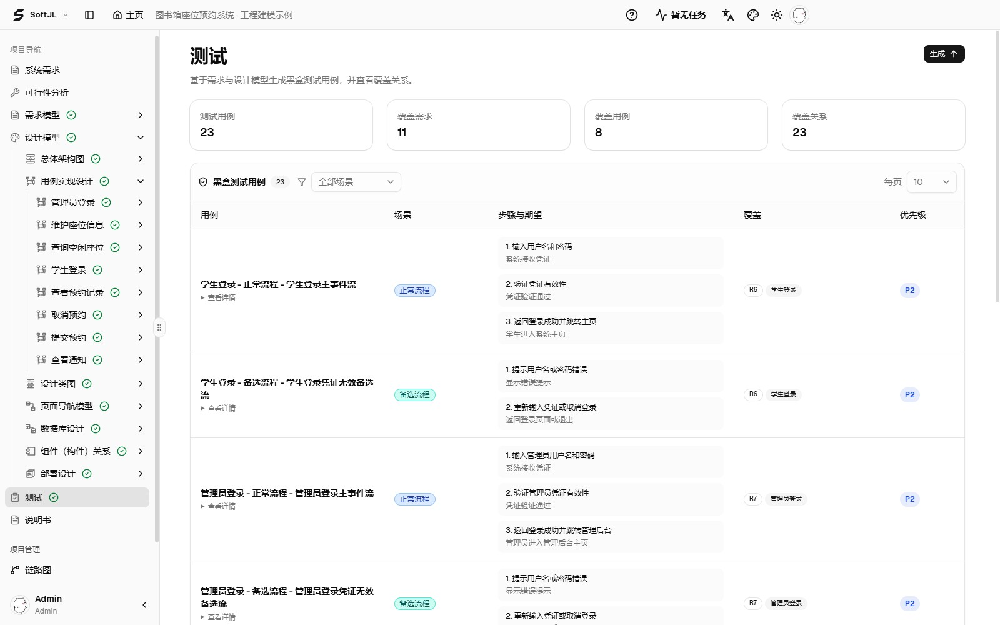
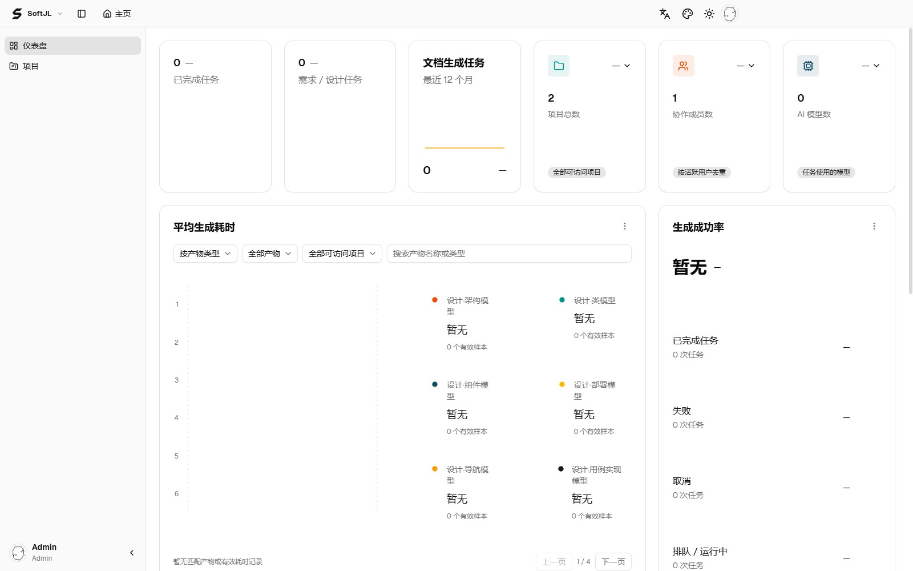

<!-- 沿用原版项目首页的视觉结构，介绍独立 Windows 桌面版。 -->

[SoftJL 官网](https://jianglisoftware.com) · [在线使用手册](https://jianglisoftware.com/tutorial)

<p align="center">
  <a href="https://jianglisoftware.com">
    
  </a>
</p>

<div align="center">

# SoftJL Desktop

<p>
  <strong>面向毕设与课程设计的本地建模工作台</strong><br />
  用 AI 关联需求、UML、设计、测试与说明书，提供检查与修改依据，支持自带模型<br />
  <sub>检查覆盖 · 查看更新影响 · 梳理答辩依据</sub>
</p>

<p>
  <a href="https://jianglisoftware.com"></a>
  <a href="https://jianglisoftware.com/tutorial"></a>
  <a href="./LICENSE"></a>
</p>

<p>
  
  
  
  
  
</p>

> 设计有依据，修改有方向。围绕同一份需求检查模型、测试和说明书，查看修改影响，整理汇报与答辩时能讲清的设计依据。

</div>

## 项目简介

**从一段系统需求，整理 UML 图、测试用例和可编辑的 Word 说明书。** 再沿来源关系检查需求变化影响了哪些项目材料，为项目评审、汇报与答辩准备依据。



**一个预约流程，6 个参与者、19 条消息、3 个条件分支**，展示预约成功、座位被占用及重复预约的交互。使用准备好的示例项目，在应用中文界面中实际截取。

SoftJL Desktop 是面向软件类毕设与课程设计的个人本地工作台。打开即进入项目列表，无需注册登录；项目、图表、文档和历史保存在自己的电脑里，建模继续使用你配置的 OpenAI 兼容模型服务。

快速建模适合先讨论需求、按需画图；工程建模适合分阶段完成分析与设计。两种流程都支持自带模型，名称不表示付费档位，详细对比放在下方“核心能力”。

- **查看设计来源**：沿需求、模型与测试之间的关联，核对覆盖情况、解释设计依据。
- **定位修改影响**：需求变化后，结合依赖关系与更新状态查找需要复核的材料。
- **保留已完成成果**：失败模型可单独重试，已成功产物继续保留；任务历史展示供应商报告的实际用量。

[查看对话建模](#快速建模) · [查看完整功能对比](#核心能力) · [桌面启动](#快速开始) · [了解生成链路](#生成链路优化)

## 界面预览

桌面版直接进入项目列表，不需要登录注册。模型服务与工作区在应用内配置。

以下五张截图均来自当前 Windows 桌面应用，使用独立演示工作区中的图书馆座位预约示例。示例对话与模型为预置数据，测试用例由示例需求和事件流生成；昵称和用户名均为 Admin。

### 快速建模

通过对话输入需求、查看工具执行状态，并从左侧打开已保存模型。


示例设计类图包含 **20 个类、4 个接口、2 个枚举和 21 条关系**，覆盖控制器、业务服务、仓储与领域对象，可查看属性、方法及关联。


### 工程建模

按需求、可行性、建模、测试和说明书流程逐步推进，在工作区检查模型元素与来源关系。

示例预约时序图包含 **6 个参与者、19 条消息和 3 个条件分支**，展示预约成功、座位被占用及重复预约时的交互。

[查看上方完整预约时序图](#项目简介)。

### 测试场景与覆盖

示例包含 **23 个测试用例，关联 11 条需求规则、8 个用例**，覆盖登录、座位查询、提交预约、通知、取消预约和座位维护的正常、备选及异常流程。来源映射需复核，用例需在实际系统执行；建立关联不等于测试通过。



### 项目仪表盘

下图为当前演示工作区的仪表盘：有 2 个示例项目，没有模型供应商调用记录，因此任务数量为 0，生成耗时显示暂无。统计取决于本地项目与实际任务记录。



<details>
<summary>生成耗时的统计口径</summary>

**平均生成耗时**图表按产物统计：模型从子任务进入运行到产物就绪；可行性产物从对应生成阶段开始到产物就绪；说明书从正文生成阶段开始到文件生成并保存完成，包含这段期间适用的修复、审查与渲染。旧记录若只有独立生成调用的起止时间，则使用该调用边界；缺失或无效时间不计入均值，并行模型各自计时。项目列表按成功完成的整次任务计算平均耗时，从第一个阶段开始到任务完成；最近任务显示到完成、失败或取消的时长。首阶段开始前的排队等待不计入。

</details>

## 需求改得动，设计查得到，答辩讲得清

面向软件类毕业设计、课程设计和 UML 作业，帮助学生检查需求是否落实到设计与测试、修改后哪些材料需要更新，以及汇报时怎样说明设计来源。

| 你需要检查什么 | 平台如何帮助 | 可以整理的依据 |
| --- | --- | --- |
| 需求修改后，哪些设计要更新 | 保存并确认新规则，沿链路图查看关联产物与需更新状态 | 需求基线、来源关系与更新影响 |
| 提交前，哪些需求缺少设计或测试依据 | 从跟踪矩阵定位缺失或待复核关系，检查正常、异常与边界测试 | 覆盖缺口与需要复核的设计内容 |
| 图表与说明书中的描述是否一致 | 从已保存模型和设计生成说明书，对照图表检查并编辑正文 | 可编辑、可管理版本的 DOCX 说明书 |
| 汇报或答辩时，怎样解释设计来源 | 回看需求、设计、测试的关联与任务历史 | 讲解设计选择和测试覆盖的依据 |

来源连线和覆盖数量用于定位检查内容，仍需打开模型核对具体约束与行为。平台生成的测试用例需要在实际系统中执行；图表、说明书和代码的业务一致性需要人工检查与运行证据。

### 可以准备哪些项目材料

- **分析与设计**：需求规则、可行性分析、UML 模型与系统设计。
- **测试与讲解依据**：测试用例、覆盖矩阵、追踪矩阵和任务记录，帮助核对自己的工作。
- **工程文档**：可行性研究报告、需求规格说明书、软件设计说明书，支持版本管理与 DOCX 下载；支持浏览器内 DOCX 预览；下载后可用 Word 兼容编辑器修改。

生成后仍需检查内容、按学校要求整理文档并验证系统运行结果。工程说明书可作为项目报告的材料，不等同于完整毕业论文。

## 用图书馆座位预约系统走一遍

```text
学生登录后查询空闲座位，选择日期和时间段提交预约。
同一学生同一时间段不能重复预约。预约成功后，系统发送通知。
管理员可以维护座位、查看预约记录，并处理异常取消。
```

1. 创建项目并配置模型，输入需求、提取并确认规则。
2. 完成三项可行性分析，核对系统边界、流程和实现方案。
3. 生成需求模型，再按前置条件生成设计模型，查看来源关系。
4. 生成测试用例并检查覆盖；生成、检查并下载三类说明书。
5. 需求变更后按依赖顺序更新受影响产物，在实际系统中执行测试。

图表与覆盖数量帮助定位检查内容，生成结果仍需人工评审。测试用例需在实际系统执行，工程说明书可作为项目报告材料。

## 核心能力

### 快速建模与工程建模对比

✅ 表示支持，— 表示不启用；两者是建模流程，不是收费档位。想先画出几张图可以选快速建模，需要完整过程材料再选工程建模。

| 能力 | 快速建模 | 工程建模 | 支持范围与说明 |
| --- | :---: | :---: | --- |
| 💬 持续对话整理需求 | ✅ | — | 快速建模通过对话按需生成和修改；工程建模按阶段推进 |
| 📐 八类按需图表 | ✅ | — | 功能结构、用例、活动、架构、E-R、类、顺序、表关系 |
| 📝 需求规则提取与确认 | 对话整理 | ✅ | 工程流程保存确认后的需求规则与来源 |
| 🧭 三项可行性分析 | — | ✅ | 系统环境、业务与系统流程、实现方案 |
| 🏗️ 完整需求与设计阶段 | 按需选择图种 | ✅ | 工程建模按阶段约束模型语义与前置条件 |
| 🎨 模型编辑、校验与导出 | ✅ | ✅ | 具体图种校验与确定性 PlantUML 绘图 |
| 🔗 工程来源追踪与变更影响 | — | ✅ | 来源映射、依赖检查、追踪矩阵与待更新提示 |
| 🧪 测试用例 | ✅ | ✅ | 生成后仍需在实际系统执行验证 |
| 📄 需求规格与软件设计说明书 | ✅ | ✅ | DOCX 预览、版本保存与下载 |
| 📄 可行性研究报告 | — | ✅ | 基于可行性成果生成 |

### 桌面端、社区版与官网版对比

**桌面端**是本仓库的个人 Windows 应用，**社区版**是自行部署的服务，**官网版**是 [SoftJL 官网](https://jianglisoftware.com)的托管服务。沿用原版能力表的标记方式；官网能力仍取决于当前部署、账号权限和配置。

| 能力 | 桌面端 | 社区版 | 官网版 | 支持范围与说明 |
| --- | :---: | :---: | :---: | --- |
| 📝 需求规则提取与确认 | ✅ | ✅ | ✅ | 需求提取、来源保留、修订与规则到模型映射 |
| 🧭 可行性分析：系统环境图 | ✅ | ✅ | ✅ | 梳理系统边界、外部角色与交互 |
| 🧭 可行性分析：业务与系统流程图 | ✅ | ✅ | ✅ | 描述业务过程与系统处理流程 |
| 🧭 可行性分析：实现方案 | ✅ | ✅ | ✅ | 候选方案、成本收益与风险分析 |
| 📐 完整需求模型 | ✅ | ✅ | ✅ | 功能结构、总体业务流程、用例、领域概念、原型界面关系、部署需求、需求分析模型 |
| 🏗️ 完整设计模型 | ✅ | ✅ | ✅ | 总体架构、用例实现、设计类、页面导航、数据库、组件关系、部署设计 |
| 🧪 测试用例与覆盖矩阵 | ✅ | ✅ | ✅ | 正常、异常与边界场景；生成结果需在实际系统中执行验证 |
| 📄 可行性研究报告 | ✅ | ✅ | ✅ | 生成、版本管理与 DOCX 下载 |
| 📄 需求规格说明书 | ✅ | ✅ | ✅ | 生成、版本管理与 DOCX 下载 |
| 📄 软件设计说明书 | ✅ | ✅ | ✅ | 生成、版本管理与 DOCX 下载 |
| 👁️ 内置 DOCX 预览与下载 | ✅ | ✅ | ✅ | 在浏览器预览生成结果，下载后使用 Word 兼容编辑器修改 |
| 🎨 图表编辑与导出 | ✅ | ✅ | ✅ | PlantUML 编辑与 SVG 导出 |
| 🔗 来源追踪与变更影响 | ✅ | ✅ | ✅ | 查看产物来源、依赖关系与版本变化 |
| 👥 成员、角色与邀请 | — | ✅ | ✅ | 桌面端仅个人使用；社区版与官网版保留账户和项目权限 |
| ⏱️ 生成任务、历史与重试 | ✅ | ✅ | ✅ | 查看运行记录并重试失败任务 |
| 🤖 自带模型服务（BYOK） | ✅ | ✅ | ✅ | OpenAI 兼容供应商、模型发现与连接测试；调用费用由模型供应商结算 |
| ☁️ 官网托管模型 | — | — | ✅ | 按账号可用配置、模型目录与生成权益使用 |
| 💳 平台账单、支付与生成次数 | — | — | ✅ | 购买、订单与权益管理；社区版无需购买平台生成次数 |
| 🛠️ 运营管理后台 | — | — | ✅ | 官网运营人员使用，普通账号不开放 |
| 📦 开源源码与独立运行 | ✅ | ✅ | — | 桌面版生成 Windows 安装包；社区版自行部署服务 |
| 🌐 免部署在线使用 | — | — | ✅ | 直接访问官网，由平台维护托管服务 |
| 🪟 Windows 独立安装包 | ✅ | — | — | 内含数据库、Java、PlantUML 与导出资源 |
| 🏠 本地免登录、数据落盘 | ✅ | — | — | 打开项目列表直接使用，无团队邀请与密码入口 |

## 生成链路优化

生成流程重点优化等待时间，减少重复模型输入。

- **按依赖组织上下文**：仅携带当前任务来源；单用例生成保留目标及 include/extend 等依赖，业务约束与完整目标模型继续保留。
- **按任务持续修复模型**：生成和渲染阶段沿用同一会话并共享五次修复上限，模型、来源与绘图校验通过后一起发布；实现方案和文档章节保留局部补丁协议。
- **并行推进与失败项重试**：独立设计分支并行处理，重试失败模型实例时保留已成功成果。
- **普通版与专业版项目**：普通版通过持续对话按需生成图表；专业版保留需求、可行性、设计、测试和追踪的完整流程。两者均支持自带模型，名称不表示付费档位。
- **展示实际消耗**：任务历史汇总供应商报告的输入、输出、缓存等 Token，包含适用的修复与失败调用，缺失用量不补造。
- **内置文档预览**：直接预览 DOCX，无需单独部署文档服务器。

实际总耗时和 Token 受项目规模、模型、供应商延迟及修复次数影响；任务历史展示实际报告的用量，不补造缺失数据。

## 快速开始

### 1. 准备环境

桌面版当前面向 Windows x64。源码开发使用 Node.js 24 LTS 与 npm；使用打好的安装包无需另装 Node.js、PostgreSQL 或 Redis。

### 2. 安装依赖并启动

~~~powershell
npm ci
node scripts/prepare-runtime.mjs
npm run dev
~~~

首次构建会下载所需 Java 运行时与 PDF 中文字体。应用启动直接到项目列表，数据持续保存在当前 Windows 用户的应用数据目录中。

### 3. 配置模型

点击应用设置按钮，配置模型服务地址、API Key 与模型。创建快速建模或工程建模项目，描述需求并生成、保存设计与文档。模型调用费用由供应商账户结算。

### 4. 打包成安装程序

~~~powershell
npm run package
~~~

安装包输出至 release，包含 Electron、内嵌数据库、Java、PlantUML 和导出资源，当前未配置发行签名。参见 [桌面运行与打包](docs/development/desktop-runtime.md)。

## 技术架构

~~~mermaid
flowchart LR
  A[需求文本] --> B[确认的需求规则]
  B --> C[可行性分析]
  B --> D[需求模型]
  D --> E[设计模型]
  E --> F[测试与覆盖]
  C --> G[工程说明书]
  D --> G
  E --> G
~~~

| 目录 | 职责 |
| --- | --- |
| src/main | Electron 窗口、本地后台、建模流水线、渲染和文档 |
| src/preload | 受限原生操作桥接 |
| src/renderer | 桌面窗口与 React 建模界面 |
| src/shared | 共享契约、桥接类型与演示数据 |
| resources | 静态资源、图标与 PlantUML |
| scripts、tests | 构建、运行时准备与应用验证 |

## 常用命令

| 命令 | 用途 |
| --- | --- |
| `npm run dev` | 构建并启动桌面应用 |
| `npm run build` | 构建主进程、preload 与界面，准备导出资源 |
| `npm run package` | 生成独立 Windows x64 安装包 |
| `npm run typecheck` | 检查主进程、共享契约与界面类型 |
| `npm run test:desktop` | 验证桌面窗口、本地数据与接口边界 |
| `npm run test:modeling` | 验证建模、修复、导出等业务 |
| `npm run test:renderer` | 验证界面与交互守卫 |
| `npm run smoke` | 用隔离数据检查真实 Electron 启动、渲染与保存 |
| `npm run audit:docs` | 检查文档命名、结构和链接 |

> 本地数据、密钥、运行时缓存、安装包与构建输出保持 Git 忽略。启动检查不调用真实模型。

## 开发碎碎念

最开始做这个，其实就是想让学生做课设的时候少折腾一点。需求要写，图要画，说明书还得整理成一套，来回改几轮，时间很容易花在“这张图改了，另一份材料是不是也要跟着改”上。

所以一开始只做了工程建模，想把前后的关系都串起来。结果做着做着发现，我觉得顺手的流程，别人第一次打开未必看得懂。有人只是想画张用例图，却先看到一堆阶段、规则和依赖，第一反应就是：怎么这么复杂，我还没开始呢。

后来就补了快速建模。先聊清楚想做什么，需要哪张图就画哪张，哪里不对再接着改。要认真整理完整材料的时候，工程建模也还在。没必要让每一次小作业都先走一遍完整流程。

桌面版也是顺着这个想法做的：自己的项目放自己电脑里，打开就能用，设计做好了还能接着让本地助手写代码。希望省下来的时间，能多留一点给真正理解自己的系统。图和文档毕竟只是工具，答辩时能讲清楚“为什么这么设计”，还是得靠自己。

## 文档导航

- [桌面运行与打包](docs/development/desktop-runtime.md)
- [架构与进程边界](docs/architecture/platform-overview.md)
- [模型服务接入](docs/integrations/openai-compatible-provider.md)
- [文档索引](docs/README.md)
- [贡献指南](contributing.md)
- [安全边界](security.md)

## 授权

<div align="center">

**Copyright © 2026 软件工程实践平台 · Apache-2.0**

本项目自有代码与文档采用 [Apache License 2.0](LICENSE)，允许商业使用、修改和再分发，也允许闭源修改与分发，但须遵守保留许可与相关声明、标明修改等协议条件。

第三方模板、依赖、字体、图标及 PlantUML 运行时保留各自的版权与许可，不因本项目协议变更而重新授权。相关声明与许可位置见 [NOTICE](NOTICE)；再分发时还须遵守对应组件的许可条件。

</div>
