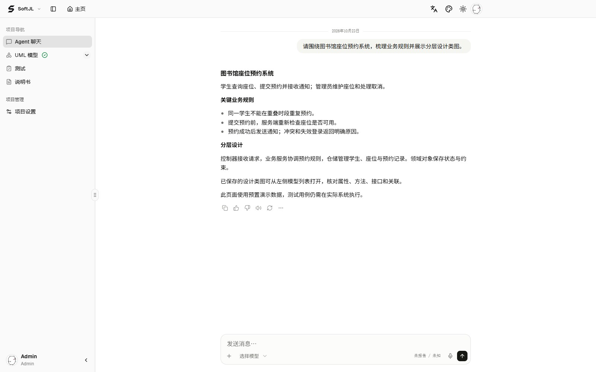
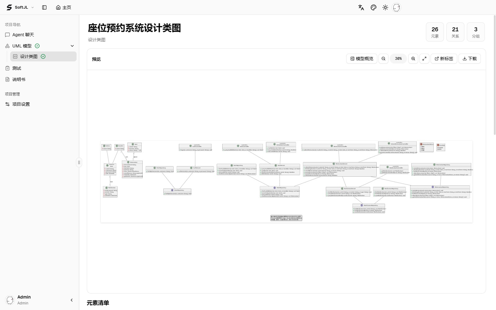

<p align="center">
  <a href="https://jianglisoftware.com/">
    
  </a>
</p>

<div align="center">

# SoftJL Desktop

<p>
  <strong>面向大学生毕业设计与课程设计的本地建模与编程助手</strong><br />
  规范图表、检查模型、跟踪过程，把需求、设计、测试、说明书与代码放在同一个项目中<br />
  <sub>UML 规范指导 · PlantUML 绘图 · 模型校验 · 任务与会话跟踪 · Pi Coding Agent</sub>
</p>

<p>
  <a href="https://jianglisoftware.com/download"></a>
  <a href="https://github.com/guolola/SoftJL-Desktop/releases"></a>
  <a href="LICENSE"></a>
</p>

<p>
  <a href="https://github.com/guolola/SoftJL-Desktop/releases/latest"></a>
  <a href="https://github.com/earendil-works/pi"></a>
  <a href="https://github.com/topics/coding-agent"></a>
  
  
  
  
</p>

从需求到设计图，从测试用例到 Word 说明书，再接着实现代码。少一些工具切换和材料整理，多一些时间理解、验证和讲清自己的系统。

</div>

## 项目简介

**SoftJL Desktop 服务于正在做软件类毕业设计、课程设计和 UML 作业的大学生**：把需求讨论、规范建模、模型检查、过程跟踪、测试用例、工程说明书和本机编码集中在一个项目中，帮助你整理提交材料、复核设计问题和准备答辩。

- **图表有规范可依**：UML 用例、活动、类和时序模型参考 OMG UML 2.5.1 的语义与记法；按结构化模型生成 PlantUML 图形，同时支持功能结构、总体架构、E-R 和数据库表关系视图。八类图表均可继续编辑和导出。
- **模型问题有检查**：生成和编辑时按图种校验结构、标识引用与关系语义，并检查实际绘图结果；失败返回具体原因，由 Agent 根据错误继续修正，减少手工排查无效关系和绘图语法的负担。
- **生成与修改过程可跟踪**：回看项目对话、工具执行和任务历史，查看本轮图表的处理中、成功或失败状态；已成功成果保留，失败项可重试，重启后可继续会话，便于整理自己的实现与修改依据。
- **课设材料能接着用**：基于项目已保存的业务和模型生成测试用例、需求规格说明书与软件设计说明书，提供 Word（DOCX）预览、版本与下载；在同一对话里继续读取代码、实现功能并运行本机测试。

应用基于 [Pi Coding Agent](https://github.com/earendil-works/pi) 实现，面向个人 Windows 用户。打开即可使用，无需注册登录；项目、模型、文档和会话记录保存在本机，模型服务由使用者自行配置（BYOK）。也适合需要同时整理设计材料与实现代码的个人开发者。

### 校验与跟踪具体做什么

| 你要检查的问题 | 当前提供的依据 | 帮助你完成什么 |
| --- | --- | --- |
| 图里是否有无效结构或关系 | 按图种检查结构字段、唯一标识、元素引用与适用的关系规则；时序模型还检查对象生命周期等语义 | 在保存和绘图前发现可检测的问题，按实际错误修改 |
| 图能否被绘图引擎正常呈现 | 由结构化模型确定性构建 PlantUML 源码，并检查渲染结果 | 查看、编辑和导出可用图形，避免只得到一段未验证的绘图文本 |
| 这轮生成或修改做到了哪里 | 图表任务状态、失败信息、项目对话、工具执行与运行历史 | 回看处理过程、定位失败项、继续对话和重试 |
| 编码与测试是否实际执行 | 本机文件修改、PowerShell 输出和工具执行记录 | 对照实际结果复核实现，整理汇报与答辩依据 |

规范指导与校验覆盖当前支持的模型字段和规则，不代表完整 OMG 元模型合规认证，也不能替代业务评审。这里的跟踪指任务、会话和工具执行记录；当前 Desktop 不提供需求到代码的自动追踪矩阵或变更影响审核。生成测试用例与实际运行测试分别记录，学校的模板和评分要求以你提供的材料为准。

创建项目后可以先整理需求、生成设计，再接着编码，也可以直接分析和修改已有工程。**当前统一使用项目对话，按任务需要调用建模能力**，无需先走完固定的工程阶段。

[官方下载](https://jianglisoftware.com/download) · [GitHub Releases](https://github.com/guolola/SoftJL-Desktop/releases) · [更新记录](changelog.md)

## 下载与安装

从 [SoftJL 官方下载页](https://jianglisoftware.com/download) 获取安装包，也可直接打开 [GitHub Releases](https://github.com/guolola/SoftJL-Desktop/releases/latest) 查看版本、下载资产与校验文件。当前提供 Windows x64（Intel / AMD 64 位）版本，未提供 ARM64、macOS、Linux 或便携版。

| 下载项 | 用途 |
| --- | --- |
| [SoftJL-Desktop-0.1.0-windows-x64-setup.exe](https://github.com/guolola/SoftJL-Desktop/releases/download/v0.1.0/SoftJL-Desktop-0.1.0-windows-x64-setup.exe) | v0.1.0 Windows 安装程序；普通用户选择此项 |
| [SHA256SUMS.txt](https://github.com/guolola/SoftJL-Desktop/releases/download/v0.1.0/SHA256SUMS.txt) | 同版本安装包的 SHA-256 校验值 |
| Release 页的 Source code (zip / tar.gz) | 对应标签的源码归档，供开发者使用，不是可直接运行的程序 |

1. 下载 `.exe`，运行安装向导并选择安装目录，然后启动 SoftJL Desktop。
2. 在设置中填写自己的模型服务、API Key 和模型。项目与会话保存在本机，模型调用按供应商规则计费。
3. 创建项目后开始对话；需要操作代码时选择本机代码目录。MCP、网页服务及开发工具按需另外配置。

安装包内含 Electron、数据库、Java、PlantUML 和导出资源，使用者无需另装 Node.js、Java 或 PostgreSQL；运行代码项目的 SDK、依赖及外部 MCP 不包含在内。当前安装包未进行代码签名，Windows 可能显示发布者未知或 SmartScreen 提示；请核对下载仓库与文件校验值后再决定是否运行。

可在下载目录运行 PowerShell，将输出与同一 Release 的 `SHA256SUMS.txt` 对照：

```powershell
Get-FileHash -Algorithm SHA256 .\SoftJL-Desktop-0.1.0-windows-x64-setup.exe
```

每个 Release 记录版本变化、依赖来源与使用限制。更新前退出应用并备份本地项目数据；v0.1.0 使用独立的 `desktop-v2` 数据库，旧版数据不会自动导入，见 [运行与打包](docs/development/desktop-runtime.md)。

## 与通用 Coding Agent 的侧重点

SoftJL Desktop 面向既要实现代码、又要整理需求、设计图和说明书的个人开发、课程设计与毕业设计。可以直接让 Agent 修复已有工程，也可以在同一项目中先讨论需求、查看结构化设计，再继续实现和验证。

文件编辑、终端、网页搜索、子代理、Skills 和 MCP 已是通用 Agent 生态中的常见能力，本项目复用 Pi 与第三方实现。差异主要在于交付物的组织和业务工具：

| 任务 | 本项目的实现 | 使用上的好处 |
| --- | --- | --- |
| 从需求讨论进入编码 | 同一项目对话读取已保存的业务、共享方案、长期约定与模型 | 减少在聊天、画图工具和编码助手之间重复转述背景 |
| 生成并继续修改设计图 | 八类图表使用结构化契约保存、校验和渲染，提供元素与关系编辑及多格式导出 | 设计成为可继续编辑的项目产物，便于检查实体、交互与数据关系 |
| 准备测试与说明书 | 专用工具生成测试用例、需求规格说明书和软件设计说明书，提供 DOCX 预览、版本与下载 | 在编码之外，也能整理评审、课程提交或项目交接需要的材料 |
| 使用本机工程与开发环境 | Windows 图形界面选择代码目录，Pi 工具操作实际文件并执行 PowerShell | 可复用已有工程、SDK 与构建测试命令，在对话中查看实际输出 |
| 维护个人项目与扩展 | 项目和会话本地保存，内置数据库、绘图运行时以及 MCP / Skills 管理页 | 无需部署后台；可自选模型和外部工具，按任务补充工作流 |

这些设计不代表模型推理或编码正确性优于其他产品，也不保证更低费用或更快速度。模型与代码目前没有自动双向同步；生成测试用例不等于已运行测试，图表、文档和实现的一致性仍需检查。具体成本与效果取决于所选模型、工程规模和实际验证。

## Pi、插件与自有实现

当前锁定 [Pi](https://github.com/earendil-works/pi) 1.3.0：`@earendil-works/pi-coding-agent`、`pi-agent-core`、`pi-ai` 与 `pi-mcp`。Pi 提供 Agent 会话与工具循环、历史和压缩机制、资源加载、文件与 PowerShell 工具及 MCP 接入；SoftJL 负责把这些能力装配到 Electron 项目对话中。

| 层次 | 来源与职责 |
| --- | --- |
| Pi 上游 | 通用 Agent 运行时、SDK、原生工具与 MCP / Code Mode / Tool Search 扩展；不属于 SoftJL 自研 |
| 第三方 Pi 插件 | 下表五个包提供问卷、摘要策略、搜索、网页研究和子代理；随应用安装，按会话条件加载 |
| SoftJL 自有业务实现 | 项目与会话持久化、模型与业务契约、范围校验、结构化图表生成与编辑、PlantUML 渲染装配、测试用例和 DOCX 说明书流水线 |
| SoftJL 桌面适配 | 目录选择与续聊、Pi 交互协议到 React 的桥接、MCP / Skills 配置、凭证保存与每轮配置快照；界面也使用 assistant-ui 等第三方组件 |

### 随应用安装的第三方 Pi 插件

| 插件与上游 | 锁定版本 | 用途 |
| --- | --- | --- |
| [@juicesharp/rpiv-ask-user-question](https://github.com/juicesharp/rpiv-mono/tree/main/packages/rpiv-ask-user-question) | 2.13.9 | 业务澄清、编码选择与模型范围问卷 |
| [pi-custom-compaction](https://github.com/nicobailon/pi-custom-compaction) | 0.2.5 | 长会话的自定义摘要与上下文压缩策略 |
| [pi-fff](https://github.com/ShpetimA/pi-fff) | 0.1.13 | 本机文件索引、模糊路径搜索与增强 read/grep |
| [pi-web-access](https://github.com/nicobailon/pi-web-access) | 0.44.0 | 网页搜索、正文读取和来源信息 |
| [@gotgenes/pi-subagents](https://github.com/gotgenes/pi-packages/tree/main/packages/pi-subagents) | 25.0.1 | 子代理任务、独立子会话与结果收集 |

未选择代码目录时加载问卷、压缩和网页插件；选择目录后再加载 fff、子代理及原生编码工具。网页后端、凭据和本机开发依赖仍需按要求配置。当前不安装或加载 `@gotgenes/pi-permission-system`，文件与命令不提供该插件的逐次授权。

SoftJL 保留三个小型依赖维护补丁，处理 fff 关闭时序、Electron ASAR 原生库路径和压缩摘要中文件操作记录的准确性；这些是对上游的局部适配。版本依据见 [package.json](package.json)，详细边界见 [集成文档](docs/integrations/agent-integrations.md)。

### 内置 Skills：自有规范与参考适配

新建配置共提供七项 Skill。两项核心技能由 SoftJL 维护并保持启用；五项工作流由 SoftJL 按本项目工具和契约编写，参考下列公开 Skill，默认启用，可编辑或停用。参考工作流不等于安装上游完整技能包，也不包含上游脚本。

| Skill 标识 | 用途 | 来源 |
| --- | --- | --- |
| `uml-graduation-modeling` | 八类图表的范围、业务语义与结构化模型规范 | [SoftJL 核心技能](src/main/modeling/runs/pipelines/standard/resources/skills/uml-graduation-modeling/SKILL.md)，含 UML 规范参考 |
| `graduation-deliverables` | 测试用例、需求规格说明书与软件设计说明书 | [SoftJL 核心技能](src/main/modeling/runs/pipelines/standard/resources/skills/graduation-deliverables/SKILL.md) |
| `requirements-discovery` | 需求澄清与验收条件 | SoftJL 适配；参考 [GitHub Copilot PRD](https://github.com/github/awesome-copilot/tree/main/skills/prd) |
| `document-collaboration` | 说明书协作与检查 | SoftJL 适配；参考 [Anthropic doc-coauthoring](https://github.com/anthropics/skills/tree/main/skills/doc-coauthoring) |
| `codebase-architecture` | 已有工程架构分析 | SoftJL 适配；参考 [GitHub Copilot architecture-blueprint-generator](https://github.com/github/awesome-copilot/tree/main/skills/architecture-blueprint-generator) |
| `database-impact` | 数据库变更影响分析 | SoftJL 适配；参考 [GitHub Copilot sql-object-impact-analysis](https://github.com/github/awesome-copilot/tree/main/skills/sql-object-impact-analysis) |
| `web-acceptance` | 网页流程验收 | SoftJL 适配；参考 [Anthropic webapp-testing](https://github.com/anthropics/skills/tree/main/skills/webapp-testing) |

Skill 是按需读取的工作指导，不会自动赋予工具权限或安装其所需服务。管理页支持添加文本技能；运行时使用应用内显式配置的技能，不自动导入用户其他 Agent 的技能目录。

### MCP：六项第三方服务预设

内置的是连接预设与管理能力，六项服务均来自第三方，首次创建时全部关闭。应用没有捆绑这些 MCP 服务程序或 Playwright 浏览器，也不把本地建模业务工具称为自研 MCP Server。

| 预设与上游 | 用途 | 配置要求 |
| --- | --- | --- |
| [MarkItDown / Microsoft](https://github.com/microsoft/markitdown/tree/main/packages/markitdown-mcp) | 文档转文本，读取需求资料 | Python 与 markitdown-mcp |
| [DBHub / Bytebase](https://github.com/bytebase/dbhub) | 读取数据库结构与依赖 | Node.js、连接串与只读数据库账号 |
| [Filesystem / MCP servers](https://github.com/modelcontextprotocol/servers/tree/main/src/filesystem) | 读取、列出和检索工程资料 | Node.js 与明确配置的允许目录；预设只开放读取和检索 |
| [Context7 / Upstash](https://github.com/upstash/context7) | 查询框架与依赖文档 | 网络；可选 API Key |
| [Playwright / Microsoft](https://github.com/microsoft/playwright-mcp) | 浏览器操作与网页验收 | Node.js、可用浏览器和待测网页 |
| [GitHub](https://github.com/github/github-mcp-server) | 读取仓库、Issue 与 PR | 网络与个人令牌；预设请求只读模式 |

MCP 接入复用 Pi，SoftJL 自有部分是预设目录、配置与凭证管理、连接测试、会话装配和工具暴露约束。启用前需配置并测试；自定义服务按用户保存的配置运行。详见 [MCP 与 Skill 管理](docs/integrations/agent-integrations.md)。

## 界面预览



## 核心能力

### 桌面端、社区版与官网版对比

**桌面端**是本仓库的个人 Windows 应用，定位为加入建模能力的本地 Coding Agent；**社区版**是自行部署的服务，**官网版**是 SoftJL 的托管服务。✅ 表示支持，— 表示不提供。社区版与官网版原有能力沿用原表口径；本地编码相关行比较的是直接操作使用者电脑的桌面能力。

| 能力 | 桌面端 | 社区版 | 官网版 | 支持范围与说明 |
| --- | :---: | :---: | :---: | --- |
| 💬 持续对话与按需建模 | ✅ | ✅ | ✅ | 桌面端统一使用项目对话，可直接编码，也可按需生成和修改八类模型 |
| 📝 对话需求澄清与项目约定 | ✅ | ✅ | ✅ | 桌面端保存对话、共享方案与长期约定，编码时可继续读取 |
| 📝 工程需求规则提取与基线确认 | — | ✅ | ✅ | 独立规则、来源保留、修订与规则到模型映射；桌面端已移除该工程流程 |
| 🧭 可行性分析：系统环境图 | — | ✅ | ✅ | 工程阶段产物；桌面端不提供独立可行性流程 |
| 🧭 可行性分析：业务与系统流程图 | — | ✅ | ✅ | 工程阶段产物；桌面端仍可按需生成八类模型中的业务流程图 |
| 🧭 可行性分析：实现方案 | — | ✅ | ✅ | 工程阶段的候选方案、成本收益与风险分析 |
| 📐 八类按需图表 | ✅ | ✅ | ✅ | 功能结构、用例、业务流程、总体架构、概念 E-R、设计类、时序和数据库表关系 |
| 📐 工程建模：完整需求模型 | — | ✅ | ✅ | 包含领域概念、原型界面关系、部署需求等阶段专用产物，不等同于八类按需图表 |
| 🏗️ 工程建模：完整设计模型 | — | ✅ | ✅ | 包含用例实现、页面导航、组件关系、部署设计等阶段专用产物 |
| 🧪 测试用例生成 | ✅ | ✅ | ✅ | 生成测试步骤、预期结果与分类；生成用例本身不表示程序测试通过 |
| 🧪 工程测试覆盖矩阵 | — | ✅ | ✅ | 工程覆盖检查；桌面端已移除覆盖矩阵 |
| 📄 可行性研究报告 | — | ✅ | ✅ | 桌面端不提供该报告及其前置分析流程 |
| 📄 需求规格说明书 | ✅ | ✅ | ✅ | 生成、版本管理与 DOCX 下载 |
| 📄 软件设计说明书 | ✅ | ✅ | ✅ | 生成、版本管理与 DOCX 下载 |
| 👁️ 内置 DOCX 预览与下载 | ✅ | ✅ | ✅ | 预览生成结果，下载后可使用 Word 兼容编辑器修改 |
| 🎨 图表编辑与导出 | ✅ | ✅ | ✅ | 桌面端支持结构化元素与关系编辑，以及 SVG、PNG、PDF 和 PlantUML 下载 |
| 🔗 工程来源追踪与变更影响 | — | ✅ | ✅ | 桌面端已移除来源追踪矩阵、依赖与变更影响审核页面 |
| 💻 本地 Coding Agent 与代码目录 | ✅ | — | — | 在使用者选定的本机目录读取、创建和修改文件，可处理已有代码项目 |
| 🛠️ 本机 PowerShell、构建与测试 | ✅ | — | — | 执行真实命令并展示输出；编译器、SDK 与项目依赖由本机提供 |
| 🧩 建模上下文直接用于本机编码 | ✅ | — | — | 同一 Pi 会话读取已保存的需求、模型、测试用例和说明书，再据此实现或修改代码 |
| 🔎 本机 fff 代码搜索 | ✅ | — | — | 选择代码目录后启用索引、文件定位和增强 read/grep |
| 🌐 桌面内置网页搜索与读取扩展 | ✅ | — | — | 集成网页研究与来源展示；网页服务仍需按要求配置 |
| 🤝 本机编码子代理 | ✅ | — | — | 子代理执行任务，回传结果和权限请求；并发与轮次由扩展配置管理 |
| 🛑 本机任务停止与询问取消 | ✅ | — | — | 可停止本轮任务或取消问卷；不提供逐工具授权，停止保留已完成的修改 |
| 🔌 桌面 MCP 与 Skills 设置 | ✅ | — | — | 在应用中管理外部工具和技能；运行环境与服务凭证按需配置 |
| 👥 成员、角色与邀请 | — | ✅ | ✅ | 桌面端面向个人使用，无团队协作入口 |
| ⏱️ 生成任务、历史与重试 | ✅ | ✅ | ✅ | 保存运行记录并重试失败项；桌面端还保留 Pi 会话与工具记录，支持上下文压缩和重启续聊 |
| 🤖 自带模型服务（BYOK） | ✅ | ✅ | ✅ | OpenAI 兼容模型服务；调用费用由模型供应商结算 |
| ☁️ 官网托管模型 | — | — | ✅ | 按账号可用配置、模型目录与生成权益使用 |
| 💳 平台账单、支付与生成次数 | — | — | ✅ | 桌面端与社区版无需购买平台生成次数，模型调用仍产生供应商费用 |
| 🛠️ 运营管理后台 | — | — | ✅ | 官网运营人员使用，普通账号不开放 |
| 📦 开源源码与独立运行 | ✅ | ✅ | — | 桌面端生成 Windows 安装包；社区版自行部署服务 |
| 🌐 免部署在线使用 | — | — | ✅ | 官网提供托管服务 |
| 🪟 Windows 独立安装包 | ✅ | — | — | 内含数据库、Java、PlantUML 与导出资源 |
| 🏠 本地免登录、数据落盘 | ✅ | — | — | 打开项目列表直接使用，项目数据保存在本机；外部模型与 MCP 仍会接收调用所需上下文 |

### 优势与限制

| 优势 | 对应限制与使用成本 |
| --- | --- |
| 需求、模型、文档和本地代码在同一对话中协作，减少手工转述设计 | 生成内容与代码仍需人工检查；模型与代码之间没有自动双向同步或完整追踪保证 |
| 能读取真实工程、修改文件并运行实际验证 | 依赖本机开发环境；命令使用当前用户权限，代码目录不构成系统沙箱；停止任务不会自动回滚文件 |
| 个人数据本地保存，安装包内置数据库和绘图运行时，无需部署后台服务 | 当前面向个人 Windows x64 使用，无团队协作入口；调用外部模型或 MCP 时，相关上下文仍会发送给对应服务 |
| 可自选模型服务，本地不设置 LLM 请求并发上限 | 需自行承担模型调用费用和供应商限流；子代理仍遵循其扩展配置，并行调用会增加资源与额度消耗 |
| 可按需建模，也可直接进入编码，适合已有项目迭代 | 已移除工程建模模式；需要需求基线、可行性流程、覆盖矩阵和变更影响审核时，当前 Desktop 无法提供完整流程 |
| 可扩展 MCP、Skills、网页研究与子代理工具 | 外部服务的账号、凭证、运行环境和可用性需要自行维护；已安装扩展不代表其依赖服务已配置完成 |



## 快速开始

使用安装包请先看 [下载与安装](#下载与安装)；以下步骤适用于首次启动后的使用。

1. 打开应用，在设置中配置模型服务、API Key 和可用模型。
2. 创建项目，填写名称和业务描述；需要编码时可同时选择项目代码目录。
3. 在聊天中提出具体任务，例如“阅读这个项目并修复问题”或“整理需求，生成类图并实现接口”；生成模型时按询问确认范围。
4. 编码时查看实际文件修改与验证输出；尚未设置代码目录时，可按对话提示选择文件夹并继续，执行中可停止本轮任务。
5. 从侧栏查看已生成的图表、测试和说明书，在原对话中继续修改。代码目录也可在项目设置中选择或更换。

模型调用费用由供应商账户结算。运行中的会话可以停止；停止不会撤销已经完成的文件修改。

## 常用命令

源码开发推荐 Node.js 24 LTS（最低要求见 `package.json`），并准备 Windows 桌面开发环境。

```powershell
npm ci
node scripts/prepare-runtime.mjs
npm run dev
```

常用验证与打包命令：

```powershell
npm run typecheck
npm run test:desktop
npm run test:modeling
npm run test:renderer
npm run audit:docs
npm run build
npm run package
```

数据、缓存、生成文件及凭证不加入源码版本控制。当前使用独立的 `desktop-v2` 数据目录，旧版数据不会自动读取、迁移或删除；当前目录的 Schema 不兼容时会明确拒绝打开。

## 技术架构

- `src/main`：Windows 原生能力、本地后台与项目会话运行时。
- `src/preload`：受控的原生桥接。
- `src/renderer`：React 应用、项目聊天与产物界面。
- `src/shared`：模型、项目、文档与桥接契约。

## 文档导航

- [项目文档](docs/README.md)
- [桌面架构](docs/architecture/platform-overview.md)
- [建模能力](docs/architecture/modeling-capabilities.md)
- [运行与打包](docs/development/desktop-runtime.md)
- [MCP 与 Skill 管理](docs/integrations/agent-integrations.md)
- [版本更新记录](changelog.md)
- [协作规范](AGENTS.md)

## 授权

本项目采用 [Apache-2.0](LICENSE)。引用的组件、图标、字体和集成包保留各自的许可证。
